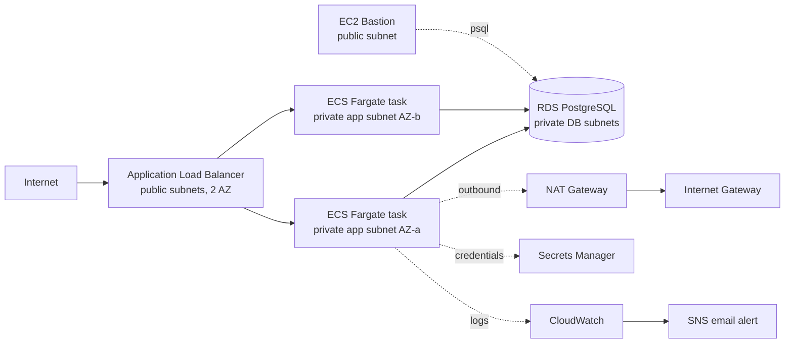

# Containerized To-Do App on AWS (ECS Fargate + RDS)

A Flask To-Do application deployed on AWS in a secure, highly available setup: custom VPC, private subnets, RDS PostgreSQL, ECS Fargate behind an Application Load Balancer, CloudWatch monitoring with SNS alerts, and a zero-downtime rolling update.

**Application URL:** `http://<ALB-DNS-NAME>` *(deleted after cleanup)*

## Architecture



## AWS services used
VPC, EC2, ECR, ECS (Fargate), RDS (PostgreSQL), IAM, Secrets Manager, CloudWatch, SNS, ALB, AWS CLI, Docker.

## Repository structure
```
app/        Flask source code, requirements.txt, Dockerfile
ecs/        ECS task definition JSON
screenshots/
README.md
```

---

## Part A: Networking

**VPC:** `todo-vpc`, CIDR `10.0.0.0/16`, region `ap-south-1`, 2 Availability Zones.

| Subnet | Type | AZ | CIDR | Route table |
|---|---|---|---|---|
| todo-public-1 | Public | ap-south-1a | 10.0.1.0/24 | todo-rt-public |
| todo-public-2 | Public | ap-south-1b | 10.0.2.0/24 | todo-rt-public |
| todo-app-1 | Private (app) | ap-south-1a | 10.0.11.0/24 | todo-rt-app |
| todo-app-2 | Private (app) | ap-south-1b | 10.0.12.0/24 | todo-rt-app |
| todo-db-1 | Private (DB) | ap-south-1a | 10.0.21.0/24 | todo-rt-db |
| todo-db-2 | Private (DB) | ap-south-1b | 10.0.22.0/24 | todo-rt-db |

| Component | Details |
|---|---|
| Internet Gateway `todo-igw` | Attached to the VPC. Public subnets route `0.0.0.0/0` to it. |
| NAT Gateway `todo-nat` | In todo-public-1 with an Elastic IP. App subnets route `0.0.0.0/0` to it (outbound only). |
| `todo-rt-db` | Local route only, so the database has no internet access. |

### Security groups
| Security group | Inbound rule | Source |
|---|---|---|
| todo-alb-sg | TCP 80 | 0.0.0.0/0 |
| todo-ecs-sg | TCP 5000 | todo-alb-sg |
| todo-rds-sg | TCP 5432 | todo-ecs-sg, todo-bastion-sg |
| todo-bastion-sg | TCP 22 | My IP only (/32) |

Tiers reference each other's security groups instead of IP addresses. The only IP-based rule is SSH to the bastion.

---

## Part B: Database and Bastion Host

- **RDS:** PostgreSQL `db.t3.micro`, identifier `todo-db`, database `todo`, user `todoadmin`.
- **Subnet group:** `todo-db-subnets` (todo-db-1 and todo-db-2 only).
- **Public access:** disabled. Security group: `todo-rds-sg`.
- **Credentials:** managed by AWS Secrets Manager (no passwords in code).
- **Bastion:** EC2 `t3.micro` in todo-public-1 with security group `todo-bastion-sg`.

Connecting from the bastion:
```bash
ssh -i todo-key.pem ec2-user@<BASTION_PUBLIC_IP>
sudo dnf install -y postgresql15
psql "host=<RDS_ENDPOINT> port=5432 dbname=todo user=todoadmin sslmode=require"
```
```sql
CREATE TABLE tasks (
  id SERIAL PRIMARY KEY,
  title VARCHAR(255) NOT NULL,
  status VARCHAR(20) NOT NULL DEFAULT 'pending',
  created_at TIMESTAMP NOT NULL DEFAULT NOW()
);
INSERT INTO tasks(title, status) VALUES ('Sample task', 'pending');
```

## Part C: Containerization and ECR

- Flask app with `/` (list and add tasks) and `/health` endpoints.
- Database settings come from environment variables: `DB_HOST`, `DB_PORT`, `DB_NAME`, `DB_USER`, `DB_PASSWORD`.
```bash
docker build --platform linux/amd64 -t todo-app:v1 app/
aws ecr create-repository --repository-name todo-app --region ap-south-1
aws ecr get-login-password --region ap-south-1 | docker login --username AWS --password-stdin <ACCOUNT_ID>.dkr.ecr.ap-south-1.amazonaws.com
docker tag todo-app:v1 <ACCOUNT_ID>.dkr.ecr.ap-south-1.amazonaws.com/todo-app:v1
docker push <ACCOUNT_ID>.dkr.ecr.ap-south-1.amazonaws.com/todo-app:v1
```

## Part D: ECS Fargate deployment

- IAM role `todoEcsExecRole` (task execution policy plus permission to read the DB secret).
- Cluster `todo-cluster`, task definition `todo-task` (`ecs/task-definition.json`), logs to `/ecs/todo-app`.
- Credentials injected from Secrets Manager.
- ALB `todo-alb` in the public subnets, target group `todo-tg` (health check `/health`).
- Service `todo-svc`: 2 tasks in the private app subnets, no public IP.

## Part E: Monitoring and alerts

- SNS topic `todo-alerts` with an email subscription.
- CloudWatch alarm `todo-ecs-cpu-high`: ECS CPU above 70%, notifies the SNS topic.
- Tested by triggering the alarm and confirming the email arrived.

## Part F: Zero-downtime deployment (v2)

1. Changed the app title to v2, built and pushed `todo-app:v2` to ECR.
2. Registered a new task definition revision and updated the service.
3. Rolling update (minimum healthy 100%, maximum 200%): new tasks start and pass health checks before old ones are stopped.
4. Polled the ALB URL during the deployment and saw no failed requests.

Both `v1` and `v2` images remain in ECR.

---

## Troubleshooting
| Problem | Cause and fix |
|---|---|
| Subnet CIDR overlaps | A form still had the default `10.0.0.0/20`. Use the exact `/24` blocks from the plan. |
| Aurora created by mistake | Express configuration creates Aurora in the default VPC. Use Full configuration with plain PostgreSQL. |
| Task stuck in PENDING or image pull error | Check the app route table points to the NAT Gateway, and build with `--platform linux/amd64`. |
| Targets unhealthy | `todo-ecs-sg` must allow 5000 from `todo-alb-sg`, and `/health` must return 200. |
| `psql` times out from the bastion | `todo-rds-sg` must allow 5432 from `todo-bastion-sg`. |
| Secrets error when starting tasks | The ECS execution role needs `secretsmanager:GetSecretValue` on the secret. |

## Cleanup
All resources were deleted in this order: ECS service and cluster, ALB and target group, RDS and subnet group, NAT Gateway and Elastic IP, bastion, ECR repository, secret, SNS topic, CloudWatch alarms and log groups, then the VPC with its subnets, route tables and Internet Gateway.
